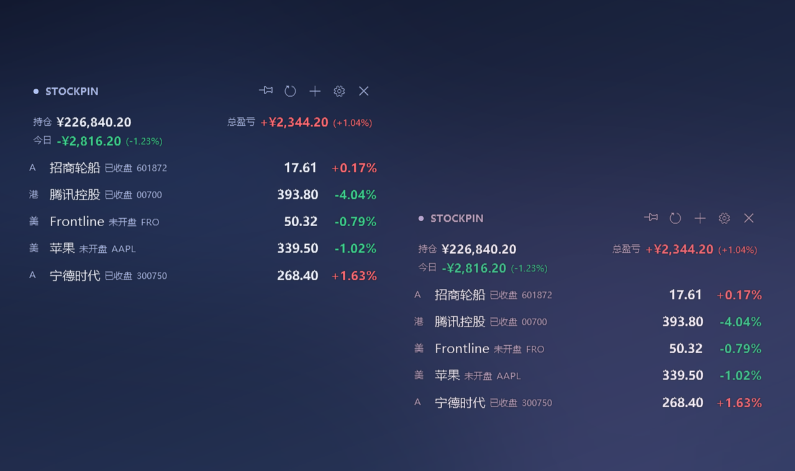
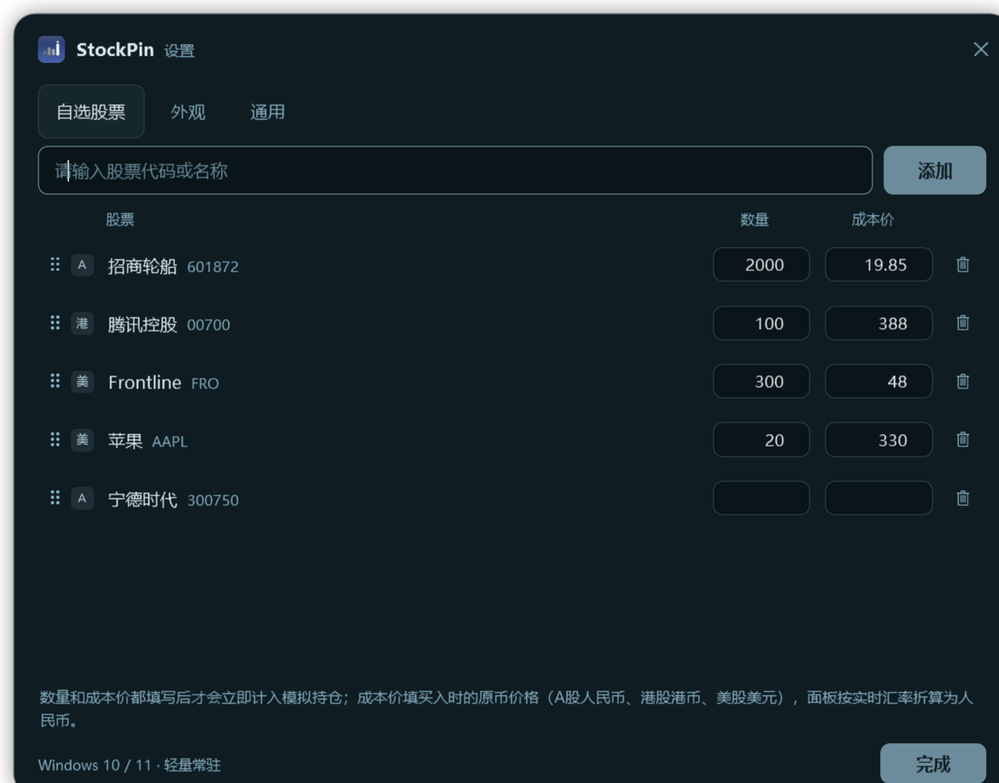
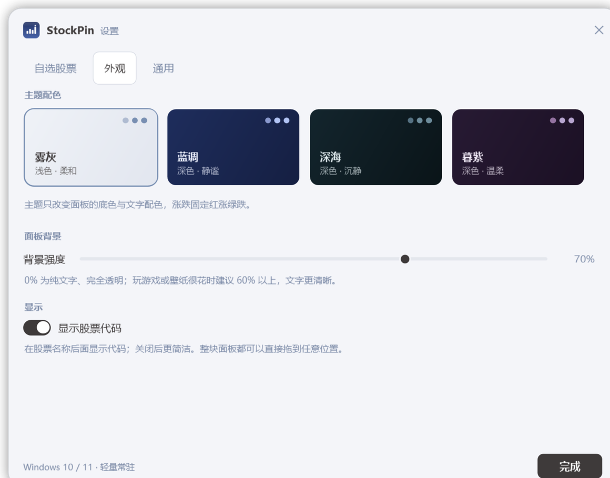

# StockPin

**轻量、全透明、始终置顶的桌面股票盯盘小工具** · A股 / 港股 / 美股 · Windows 10 / 11

[](https://github.com/AchooLuv/StockPin/releases/latest)
[](https://dotnet.microsoft.com/)
[](LICENSE)



## 功能

- **一屏看清**：股票名、状态、代码、现价、涨跌幅；`A` / `港` / `美` 标签区分市场。
- **全透明面板**：没有底板、没有边框，桌面完全透出，只保留文字；不会因为鼠标移入而冒出背景。
- **随手拖动**：整块面板都可以拖，松手自动贴边并记住位置；右上角别针一键固定，避免误拖。
- **休市标注**：非交易时段在股票名后显示「未开盘 / 已收盘 / 午间休市」，节假日同样识别，不再靠置灰判断。
- **紧凑模拟持仓**：填写数量与成本价，顶部两行显示持仓市值、总盈亏、今日盈亏、今日涨跌幅，占用空间很小。
- **多币种折算**：港股、美股持仓按实时汇率折算为人民币，混合持仓也能算总账。
- **添加 / 移除 / 排序**：输入代码或中文名即可添加（`601872`、`00700`、`FRO`、`招商轮船`），支持拖动排序和右键菜单。
- **4 套主题**：雾灰、蓝调、深海、暮紫；只改变文字与强调色，涨跌固定红涨绿跌。
- **刷新更快**：可选 1 秒刷新；所有市场都收盘时自动降到 60 秒，面板隐藏时暂停轮询。
- **省资源**：原生 WPF，不内嵌浏览器；所有行情合并成一次请求。

## 下载

到 [Releases](https://github.com/AchooLuv/StockPin/releases/latest) 下载 **StockPin.exe**，双击即用：

- Windows 10 / 11 x64，单文件，无需安装 .NET 运行时
- 免安装，配置保存在 `%APPDATA%\StockPin\config.json`
- 若首次运行出现 SmartScreen 提示，点「更多信息 → 仍要运行」

## 使用

1. 双击运行，面板默认停在屏幕右上角。
2. 面板顶部有 **固定 / 刷新 / 添加 / 设置 / 隐藏** 五个图标，悬停显示提示。
3. 直接按住任意文字拖动面板；松手会自动贴边并保存位置。
4. **右键面板**：添加股票、设置、固定位置、窗口置顶、隐藏、退出。
5. **设置 → 自选股票**：输入代码或名称添加；在右侧填写数量、成本价即可看到模拟持仓。
6. 点 **×** 只是收进托盘；托盘图标右键可再次显示面板或退出。



## 主题

四套配色只改变文字与强调色，面板本身完全透明，涨跌始终红涨绿跌。

> 面板没有底色，建议选一套和壁纸深浅接近的主题：浅色桌面用「雾灰」，深色桌面用「蓝调 / 深海 / 暮紫」，文字最清晰。



## 数据来源

行情来自东方财富公开 HTTP 接口，免费、无需密钥，数据可能有延迟。
本项目仅用于个人盯盘与学习，**不构成任何投资建议**。

## 从源码构建

需要 .NET 8 SDK：

```bash
dotnet publish -c Release -r win-x64 --self-contained true -o dist
```

产物为 `dist/StockPin.exe`（单文件，内含运行时）。

## 项目结构

```
Views/        面板与设置窗口
ViewModels/   状态、轮询、持仓计算
Services/     行情接口、配置、开机自启
Core/         主题与数据模型
tools/        图标、截图生成脚本
```

## License

[MIT](LICENSE)
